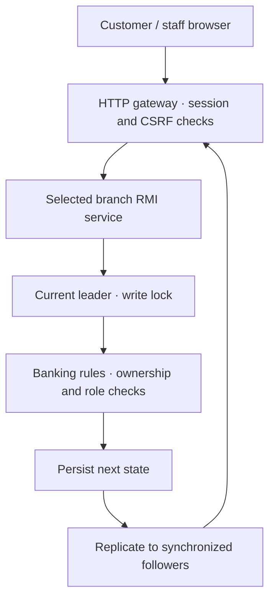

# Architecture and implementation decisions

## Application boundary

BranchSync Bank is a local educational banking application with three customer-data replicas, one browser/API gateway and three roles. It has an implemented banking domain rather than a dashboard that merely animates distributed concepts.

The gateway and RMI nodes use standard Java 17 APIs. The interface is split into authentication/shared code, an application shell, customer screens, staff screens and controllers. It uses local assets and no build framework or external CDN.

## Request flow

The selected entry branch may be a follower. It forwards the command to its known leader. The leader locks writes, reads the latest state, validates ownership/permissions, creates the next state and persists/replicates it. The domain layer is independent of HTTP, RMI and disk I/O.

## Layers

| Layer | Responsibility |
|---|---|
| domain | Immutable records for users, accounts, beneficiaries, transactions, deposits, loans, requests and audit entries; mutable aggregate state copied before commands |
| application | Business invariants and authorization; all supported commands implemented in BankingService |
| cluster | RMI contract, leader/follower coordination, logical clocks, elections, replication and managed process lifecycle |
| infrastructure | Configuration and snapshot persistence |
| security | Password hashing, opaque sessions, idle/absolute expiry and login attempt throttling |
| web | HTTP transport, cookies, CSRF, origin checks, role-gated DCS control and safe response projections |
| common | JSON serialization and canonical ordering for snapshot digests |

HTTP sessions are gateway-local. User credential versions and access states live in the replicated bank state. Each authenticated request checks that the user is still active and the session's version matches. Changing password or toggling customer access invalidates existing sessions.

## Roles and access

| Capability | Customer | Teller | Admin |
|---|:---:|:---:|:---:|
| View owned balances/history | Yes | Staff view | Staff view |
| Transfer/use customer funds | Owned accounts only | No direct customer transfer | No direct customer transfer |
| Manage personal beneficiaries/cards/deposits/loans | Yes | No | No |
| Submit cash and service requests | Owned accounts only | No | No |
| Review customer KYC | No | Yes | Yes |
| Approve/reject requests | No | Yes | Yes |
| Freeze/unfreeze customer accounts | No | Yes | Yes |
| Suspend/restore customer login access | No | No | Yes |
| View attributed banking audit | No | Yes | Yes |
| Read/control DCS processes | No | No | Yes |
| Edit own profile/password | Yes | Yes | Yes |

The gateway obtains actor identity from its server-side session, not a browser-supplied user ID. The domain validates the actor again against the state being changed. Hiding navigation is a usability choice; it is not the authorization mechanism.

Registration always creates CUSTOMER role, PENDING KYC and a zero-balance account. It cannot create a teller/admin or inject an opening balance. Initial staff identities are fictional seeded demo accounts.

## Money and service invariants

- Monetary amounts are integer paise; decimal input uses BigDecimal and rejects fractional paise.
- Transfers debit/credit a copied aggregate under one leader write lock. A failed command is discarded, leaving the existing snapshot unchanged.
- The source must be owned by the customer. Other-customer destinations must be saved as an internal beneficiary.
- Accounts must be active, the account owner active, and the acting customer KYC verified.
- Negative balances and excessive account balances are rejected.
- Daily debit limits are per account per UTC date and include transfers, bills, FD funding, loan repayments and approved cash withdrawals.
- Customer card status is separate from account status. Card freeze controls the demo card; staff account freeze blocks account operations.
- Cash requests have no immediate balance effect. Staff approval applies the validated balance movement once.
- Only a pending request can be cancelled or decided. Repeated approval cannot move money again.
- A successful command stores the original command ID/details and its result. An identical retry returns the stored result; changed details with that ID are rejected.
- Business-validation failures are not persisted as successful commands. They do not increment the committed local sequence.
- Every successful banking mutation increments state sequence and adds an actor-attributed audit record; only financial mutations append a transaction receipt.

All three nodes contain the same account dataset, not independent branch-owned databases. An internal transfer is one replicated-state update; it is not distributed two-phase commit.

## Deposits and loans

Fixed deposits reserve principal outside the available bank balance. Supported terms: 6, 12 or 24 months. Before maturity, redemption returns principal only. At/after maturity it adds simple annual interest at the demo rate of 6%, based on actual days in the original term and a 365-day denominator, rounded down to paise. Interest is posted only at redemption; there is no daily accrual scheduler.

Loans are customer applications reviewed by staff. Approval creates principal/outstanding records and credits the account. Partial/full repayments debit the account and reduce outstanding principal, closing at zero. The model intentionally excludes lending interest, EMI schedules, late fees, collateral and credit bureau checks.

Bill payments record a local settlement to an identified simulated biller. Cheque-book/support completion records a demo service decision. Card replacement changes the demo card reference; no real card network or physical dispatch is connected.

## Replication and recovery

The leader checks for a ready synchronized follower before accepting a new command. It persists its next full state, sends it to available synchronized followers and returns success after at least one follower acknowledges. Full snapshots contain identities/hashes, account data, financial and service history, audit and idempotency records.

Snapshot writes use a temporary file, flush/file sync and atomic rename where supported. Each node owns a separate directory. A periodic leader catch-up pass repairs a behind follower in the supported model.

A restarted node begins as recovering, loads its own saved state and obtains a ready replica with the largest state sequence before becoming ready. If local sequence is ahead of the active cluster, recovery is blocked for inspection rather than silently discarding unique local records. Full-cluster bootstrap is for intact compatible histories, not partition reconciliation.

Full-state replication is deliberately understandable, but its time/storage cost grows with history. No SQL database, incremental write-ahead-log streaming or HDFS is claimed.

## Elections, clocks and evidence

Known membership is Nodes 1–3. Every 1.2 seconds after startup, nodes poll peer status using RMI. A timeout is a suspicion of unreachability, not proof of a crash. Higher ready node IDs respond to election requests and the highest eligible node announces its coordinator role. This is a compact Bully-style teaching implementation with periodic known-membership polling.

Each local event advances the Lamport counter. Clock-bearing sends advance it; receives apply max(local, received)+1. The applied transaction also records a leader ID, state sequence and logical clock. Clocks show causal ordering during the running session; they are not wall-clock synchronization or a mutual-exclusion protocol.

The admin console reads real status from the RMI nodes. Its fingerprint is SHA-256 over canonicalized state (displaying 16 hex characters), so map iteration order and object identity do not create false disagreement. It is an educational equality indicator, not a full cryptographic consensus proof.

Stopping a node terminates a child Java process created by this gateway. Starting launches a new JVM with the same persisted data. The controller never kills unrelated Java processes. Last-node shutdown is blocked from the interface so cluster restoration remains possible.

## Failure-model limits

The supported demonstration assumes a reliable localhost network, fixed membership, normal disks and controlled crashes after requests finish and replicas agree. Wait for election/recovery to settle before submitting more writes.

Bully-style election is not consensus. The protocol has no consensus election terms, fencing or replicated commit index. A leader may persist before a follower acknowledges; failure mid-update can create an uncertain outcome. State sequence alone does not detect divergent histories. Neither universal linearizability nor partition safety is claimed.

An isolated node refuses new writes, but that condition by itself is not a complete quorum/consensus protocol. The gateway is a single point of availability; restarting it ends sessions, while replicated bank state remains persistent.

## Security implemented

- PBKDF2-HMAC-SHA256 with independent random 16-byte salts and 600,000 iterations.
- Constant-time derived-hash comparison.
- Random opaque server-side sessions; no auth tokens in local/session storage.
- HttpOnly and SameSite=Strict session cookies; CSRF header token on authenticated mutations.
- Browser origin checks, login-attempt throttling, 15-minute idle and 8-hour absolute session limits.
- Session rotation on login; logout removes the server session.
- Password changes/user-access changes invalidate earlier sessions through replicated credential versions.
- Explicit response projections exclude password hashes, raw commands and cluster secrets.
- HTML escaping, self-hosted scripts/assets and restrictive CSP, frame/content-type/referrer headers.
- CSV cells escape quotes and neutralize leading formula characters in text.
- RMI client/server socket factories bind internal services to 127.0.0.1; internal methods require a generated shared cluster key.

This local HTTP application does not set a Secure cookie that would require HTTPS. Production deployment would require TLS, stronger service identities, protected secrets/storage, independent security testing, real identity/payment integrations and operational/regulatory work. It is not presented as production-certified banking software.

## Syllabus alignment

| DCS concept | Concrete implementation evidence |
|---|---|
| Client–server and distributed processes | Gateway plus three child JVMs |
| Middleware / remote objects | BankRemote and RMI registry lookup |
| Marshaling | Serializable command/state records |
| Naming | Fixed node IDs and Bank registry bindings |
| Concurrent requests / mutual exclusion | RMI request threads and leader write lock |
| Logical clocks | Send/receive counter updates and event timeline |
| Leader election | Higher-ID election replies and coordinator messages |
| Failure detection | Periodic RMI peer polls with timeouts |
| Replica management | Full-state copies, follower acknowledgment and catch-up |
| Recovery | Restart readiness gate and persistent state synchronization |
| Web service / HTTP | Authenticated HTTP API and web portal |
| Retry semantics | Persisted command IDs and exact-payload comparison |

Not claimed: NFS/HDFS, CORBA, MPI/OpenMP, Ring election, NTP, distributed two-phase commit, Raft/Paxos or network-partition safety.

## References

- Oracle Java 17 RMI guide: https://docs.oracle.com/en/java/javase/17/rmi/index.html
- Oracle Java 17 HttpServer: https://docs.oracle.com/en/java/javase/17/docs/api/jdk.httpserver/com/sun/net/httpserver/HttpServer.html
- OWASP Password Storage: https://cheatsheetseries.owasp.org/cheatsheets/Password_Storage_Cheat_Sheet.html
- OWASP Session Management: https://cheatsheetseries.owasp.org/cheatsheets/Session_Management_Cheat_Sheet.html
- OWASP CSRF Prevention: https://cheatsheetseries.owasp.org/cheatsheets/Cross-Site_Request_Forgery_Prevention_Cheat_Sheet.html
- Lamport (1978), Time, Clocks, and the Ordering of Events in a Distributed System.
